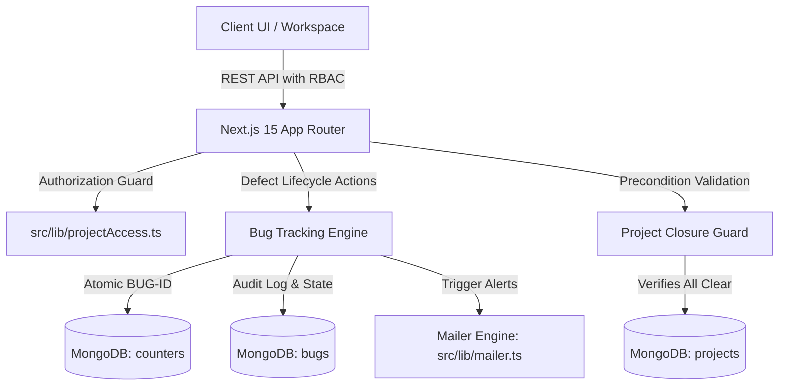

# Technical Handover & DevOps Release Documentation

**Project:** Requirement Dashboard / Kramik Workspace  
**Branch:** `feature-daksh`  
**Base Reference:** `requirement-dashboard-deployment.zip` (Base Deployment)  
**Author:** Daksh Kumar Sheregar  
**Target Audience:** DevOps Engineering Team, Lead Developers, System
Administrators

---

## 1. Executive Summary & Infrastructure Compatibility

This release introduces an enterprise-grade **Bug & Defect Tracking Lifecycle**,
**Hardened RBAC Security Defenses**, **Project Closure Integrity Checks**, and a
**Comprehensive Automated Jest Test Suite (43 tests)**.

> [!IMPORTANT] **Zero Breaking Changes to Deployment Pipelines**  
> All existing server startup scripts, Docker configurations, and PM2 process
> managers remain 100% compatible. No modifications are needed in `Jenkinsfile`,
> `ecosystem.config.js`, `copy-standalone.js`, or `start-server.js`.

### Compatibility Matrix

| Category                     | Status               | Details                                                                         |
| :--------------------------- | :------------------- | :------------------------------------------------------------------------------ |
| **Node.js Runtime**          | Node 18+ / 20+       | Fully compatible with Next.js 15.5.14 standalone output                         |
| **Environment Variables**    | No New Required Keys | Existing `.env` / `.env.local` keys suffice                                     |
| **Database**                 | MongoDB 6.0+         | **2 new collections** (`bugs`, `counters`) created automatically on first write |
| **Build Artifacts**          | Standalone Build     | Output generated cleanly under `.next/standalone`                               |
| **Pre-Push Automated Tests** | 43 / 43 Passed       | 4 test suites enforced via Husky pre-push hook                                  |

---

## 2. Architecture & Major Functional Upgrades



### 2.1 Enterprise Defect & Bug Tracking Lifecycle (Jira-Style)

- **Atomic Counter Sequence**: Implemented `src/lib/models/Counter.ts` to
  guarantee unique, collision-proof sequential IDs (e.g., `BUG-001`, `BUG-002`)
  across concurrent users.
- **Full Audit Trail**: Every status transition (Open → Under Review → In
  Progress → Resolved → Verified → Closed) logs the actor, timestamp, and
  transition remarks in the `history` array.
- **Automated PDF Export**: Implemented client/server-safe PDF report generation
  via `src/lib/bugPdfGenerator.ts` for defect documentation and sign-offs.
- **Cross-Project Global History**: Created dedicated company-wide defect portal
  at `/bug-history` for cross-project QA oversight.

### 2.2 Hardened Multi-Persona RBAC Matrix

The authorization layer in `src/lib/projectAccess.ts` was fortified across all 7
user personas:

| User Persona                       |  View Project  |    Edit Details     |   Create Tasks   | Assign Tasks |   Manage Bugs   | Delete Test Cases |
| :--------------------------------- | :------------: | :-----------------: | :--------------: | :----------: | :-------------: | :---------------: |
| **Super Admin**                    |       ✅       |         ✅          |        ✅        |  Any Member  |  Full Control   |        ✅         |
| **Project Manager (`techOwner`)**  |       ✅       |         ✅          |        ✅        |  Any Member  | Triage & Assign |        ✅         |
| **Product Owner (`productOwner`)** |       ✅       |         ✅          |        ✅        |  Any Member  | View & Comment  |        ❌         |
| **Assigned Developer**             |       ✅       | ✅ (assigned items) | ✅ (self-assign) |  Self Only   |   Resolve/Fix   |        ❌         |
| **Assigned QA Lead**               |       ✅       |    ✅ (QA items)    |        ❌        |      ❌      | Verify & Close  |        ✅         |
| **Unrelated Employee**             | ✅ (Read-Only) |         ❌          |        ❌        |      ❌      |       ❌        |        ❌         |
| **Anonymous / Unauthenticated**    |       ❌       |         ❌          |        ❌        |      ❌      |       ❌        |        ❌         |

### 2.3 Strict Project Closure Precondition Integrity

Projects can no longer be closed or marked delivered arbitrarily. The system
enforces:

1. **0 Active Work Items**: All work items must be marked `Completed`.
2. **0 Critical / High Blockers**: All critical blockers must be resolved.
3. **100% Passed Test Cases**: All QA test cases must have status `Passed`.
4. **Completed UAT Validation**: Formal user acceptance sign-off must be
   completed.
5. **3-Way Signoff**: Technical Owner, Product Owner, and QA Lead signatures
   required.

### 2.4 Overhauled Automated Email Engine

`src/lib/mailer.ts` was expanded to include formatted HTML notifications with
responsive CTA buttons for:

- Defect reported to triage manager.
- Defect assigned / reassigned to developer.
- Fix submitted by developer awaiting QA verification.
- QA verification approval and defect sign-off.

### 2.5 UI / UX Polish

- **Project Cards Cleaned**: Removed the redundant 3-dots popup menu on the
  projects index page (`src/app/projects/page.tsx`), prioritizing the
  high-visibility **Workspace** direct-launch button.
- **Main Navigation**: Added "Bug History" to the global navigation bar
  (`src/components/MainLayout.tsx`).

---

## 3. Database Schema Changes (MongoDB)

> [!NOTE] Mongoose automatically registers and creates collections upon the
> first write operation. No manual `mongosh` DDL scripts are mandatory.

### New Collections

#### 1. `bugs`

Stores project defects and lifecycle audit trails.

- **Fields**: `bugId` (string, unique), `projectId` (ObjectId ref Project),
  `title` (string), `description` (string), `severity` (`Low` | `Medium` |
  `High` | `Critical`), `status` (`Open` | `Under Review` | `In Progress` |
  `Resolved` | `Verified` | `Closed`), `reportedBy` (ObjectId ref User),
  `assignedTo` (ObjectId ref User), `history` (array of change logs),
  `attachments` (array of file metadata).
- **Recommended Index**: `{ projectId: 1, status: 1 }`, `{ bugId: 1 }` (unique).

#### 2. `counters`

Provides atomic sequence numbers for bug identifiers.

- **Fields**: `_id` (string e.g. `"bugId"`), `seq` (number).

---

## 4. API Endpoints Catalog

| Method   | Endpoint                                 | Description                                    | Authorization Guard                          |
| :------- | :--------------------------------------- | :--------------------------------------------- | :------------------------------------------- |
| `GET`    | `/api/projects/[id]/bugs`                | List bugs for project                          | Authenticated project viewers                |
| `POST`   | `/api/projects/[id]/bugs`                | Report new defect                              | Project editors (Dev, QA, PM, Admin)         |
| `GET`    | `/api/projects/[id]/bugs/[bugId]`        | Retrieve single bug details                    | Authenticated project viewers                |
| `POST`   | `/api/projects/[id]/bugs/[bugId]/action` | Perform lifecycle action (Triage, Fix, Verify) | Role-restricted (Dev for fix, QA for verify) |
| `GET`    | `/api/bugs/history`                      | Global bug audit log                           | System Admin & QA Leads                      |
| `POST`   | `/api/projects/create`                   | Create new enterprise project                  | `SYSTEM_ADMIN` only                          |
| `DELETE` | `/api/projects/[id]`                     | Hard delete project                            | `SYSTEM_ADMIN` only                          |
| `DELETE` | `/api/projects/[id]/test-cases/[testId]` | Delete test case                               | QA Lead, PM, Admin only                      |

---

## 5. DevOps Handover & Deployment Procedure

### Step 1: Fetch Latest Code

```bash
git fetch origin
git checkout feature-daksh
git pull origin feature-daksh
```

### Step 2: Validate Automated Tests

```bash
npm run test:ci
```

_Expected Output:_ `4 passed, 4 total suites | 43 passed, 43 total tests`.

### Step 3: Production Build

```bash
npm run build
```

_Next.js will build the client, server, and compile all 34 routes.
`copy-standalone.js` will automatically copy public assets to
`.next/standalone`._

### Step 4: Restart Service

Using PM2:

```bash
pm2 restart ecosystem.config.js --env production
```

Or directly via node:

```bash
npm run start
```

Or via standalone entry:

```bash
node start-server.js
```

---

## 6. Comprehensive File Audit (35 New, 22 Modified)

### New Files Created (35)

- **Defect Module APIs**:
  - `src/app/api/bugs/history/route.ts`
  - `src/app/api/projects/[id]/bugs/route.ts`
  - `src/app/api/projects/[id]/bugs/[bugId]/route.ts`
  - `src/app/api/projects/[id]/bugs/[bugId]/action/route.ts`
- **Defect UI & Components**:
  - `src/app/bug-history/page.tsx`
  - `src/components/project/ProjectBugTrackingTab.tsx`
  - `src/components/ui/JiraIcons.tsx`
  - `src/types/images.d.ts`
- **Models & Utilities**:
  - `src/lib/models/Bug.ts`
  - `src/lib/models/Counter.ts`
  - `src/lib/bugPdfGenerator.ts`
- **Automated Security & RBAC Test Suites**:
  - `tests/api/api_routes_authorization.test.ts`
  - `tests/api/project_closure_preconditions.test.ts`
  - `tests/api/rbac_permissions.test.ts`
- **CI/CD Quality Hooks**:
  - `.husky/_/*` (Lint-staged & Pre-push test hooks)

### Key Substantive Files Modified (22)

- `src/lib/projectAccess.ts` — Hardened 7-persona permission verification logic.
- `src/lib/mailer.ts` — Added bug notifications and templating engine.
- `src/lib/models/Project.ts` — Precondition validation support.
- `src/lib/models/Task.ts`, `WorkItem.ts` — Fields for assignment tracking.
- `src/app/projects/page.tsx` — Card visual clean-up (removed 3-dots popup).
- `src/app/projects/[id]/page.tsx` — Bug tab integration & closure checks.
- `src/components/MainLayout.tsx` — Bug History navigation item.
- `src/app/calendar/page.tsx` — Performance and sync improvements.
- `src/app/api/projects/*` — Privilege escalation defenses across all
  sub-routes.
